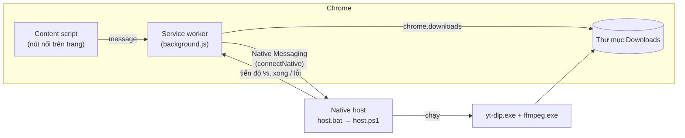

# Thiết kế: Chrome Extension tải ảnh & video (Download_Video_Image)

- **Ngày:** 2026-11-08
- **Trạng thái:** Đã duyệt (2026-11-08)
- **Hướng đã chọn:** C — Kết hợp (extension tự tải ảnh/video file thường + chương trình hỗ trợ trên máy dùng yt-dlp cho video mạng xã hội)

---

## 1. Mục đích & lý do

Chủ dự án muốn: cài extension vào Chrome, rồi trên **mọi trang web** (kể cả YouTube, Facebook, TikTok, Instagram, X, Threads, ...)
mỗi ảnh và mỗi video đều có nút **Download** để tải về máy bằng một cú bấm.

Dùng cá nhân, cài thủ công (Load unpacked) — **không** phát hành lên Chrome Web Store.

## 2. Mục tiêu / Không làm / Điều cấm

**Mục tiêu**
- Rê chuột lên ảnh hoặc video bất kỳ → hiện nút Download ở góc trên-phải → bấm là tải.
- Ảnh: `` (chọn bản nét nhất trong `srcset`), ảnh nền CSS (`background-image`), ảnh `data:` / `blob:`.
- Video file thường (`.mp4`, `.webm`, ... có URL http/https trực tiếp): extension tự tải.
- Video trên các nền tảng mạng xã hội và video dạng stream (`blob:`, HLS, DASH) trên mọi trang: gửi sang **yt-dlp** trên máy,
  tải chất lượng cao nhất có cả tiếng, ghép thành `.mp4`.
- Cài lại Windows → chỉ cần clone repo, Load unpacked, chạy `setup.bat` một lần là dùng lại được.

**Không làm (v1)**
- Phát hành Chrome Web Store; hỗ trợ Firefox / macOS / Linux.
- Tải hàng loạt (cả playlist, cả kênh, "tải mọi ảnh trên trang").
- Tách riêng âm thanh (mp3); chọn độ phân giải cụ thể (chỉ có 2 lựa chọn "dễ mở" / "MAX", xem 5.4.1).
- Nội dung có DRM (Netflix, Spotify, Disney+, ...) — không thể và không hợp pháp.

**Điều cấm (dù chạy được vẫn coi là thất bại)**
- Làm vỡ layout trang, chặn click / phát video của trang, làm trang chậm rõ rệt.
- Lưu cookie đăng nhập của người dùng xuống ổ đĩa lâu dài.
- Lỗi im lặng: bấm tải mà không có phản hồi thành công / thất bại.

## 3. Các hướng đã cân nhắc

| Hướng | Mô tả | Đánh đổi |
|---|---|---|
| A | Chỉ extension, tự bắt link stream & ghép đoạn | Không cần cài thêm, nhưng vỡ mỗi khi nền tảng đổi cách làm; YouTube gần như bất khả thi (SABR + PO token từ 2025) |
| B | Mọi thứ qua yt-dlp | Mạnh nhất cho video, nhưng ảnh cũng phải đi đường vòng và bắt buộc cài helper mới dùng được gì |
| **C (chọn)** | Ảnh + video file thường: extension tự tải. Video nền tảng/stream: yt-dlp | Ảnh dùng ngay không cần cài; video bền vì chỉ cần cập nhật yt-dlp. Phải chạy `setup.bat` một lần |

**Vì sao chọn C:** chủ dự án chọn. Đây là cách duy nhất vừa giữ được YouTube và mạng xã hội chạy bền vừa không bắt cài thêm gì để tải ảnh.

## 4. Kiến trúc



Cấu trúc thư mục dự kiến:

```
extension/            # Load unpacked thư mục này
  manifest.json       # MV3, có "key" cố định để ID extension không đổi
  background.js       # service worker: tải trực tiếp, nói chuyện với native host, badge, thông báo
  content/
    media-utils.js    # hàm thuần: srcset, CSS url, phân loại URL, đặt tên file, tìm permalink
    content.js        # nút nổi, phát hiện media dưới con trỏ, gửi lệnh tải
  icons/              # 16/32/48/128 px
native-host/
  setup.bat           # cài 1 lần: tải yt-dlp + ffmpeg, đăng ký native host
  host.bat            # Chrome gọi file này → chạy host.ps1
  host.ps1            # đọc lệnh từ Chrome, chạy yt-dlp, báo tiến độ
  bin/                # yt-dlp.exe, ffmpeg.exe (KHÔNG commit, .gitignore)
tests/                # node --test tests/
```

## 5. Các quyết định chi tiết

### 5.1 Nút Download (content script)
- **Một nút nổi duy nhất** trong Shadow DOM (closed) gắn vào `document.documentElement`, `position: fixed`, `z-index` tối đa.
  Không chèn nút vào từng ảnh (tránh vỡ layout, nhẹ trên trang nhiều ảnh).
- Phát hiện media dưới con trỏ bằng `document.elementsFromPoint(x, y)` (throttle bằng `requestAnimationFrame`), duyệt từ trên xuống:
  phần tử đầu tiên là ``, `<video>`, hoặc có `background-image: url(...)` → chọn. Bắt được cả ảnh/video bị lớp phủ trong suốt che
  (Instagram, X, TikTok đều làm vậy).
- Chỉ hiện với media hiển thị ≥ 60×60 px (bỏ icon, avatar nhỏ).
- Vị trí: góc trên-phải của media, cách mép 8px, kẹp trong viewport. Cập nhật khi scroll / resize.
- `all_frames: true` để chạy cả trong iframe (video nhúng).
- Trạng thái nút: bình thường → đang tải (hiện %) → xong ✓ → lỗi ✕ (tooltip ghi lý do).

### 5.2 Quyết định đường tải (routing)

| Trường hợp | Đường tải |
|---|---|
| Ảnh có URL http/https hoặc `data:` | `chrome.downloads.download` trực tiếp |
| Ảnh `blob:` | Content script `fetch` blob → chuyển `data:` URL → `chrome.downloads` |
| Video trên **nền tảng đã biết** (YouTube, Facebook, Instagram, Threads, TikTok, X) | **yt-dlp**, gửi *permalink* của video |
| Video ở trang khác, URL http/https trực tiếp | `chrome.downloads` trực tiếp |
| Video ở trang khác, `blob:` / stream | **yt-dlp**, gửi URL trang hiện tại (generic extractor của yt-dlp tự tìm HLS/DASH) |

### 5.3 Tìm permalink của video trên nền tảng
Trên feed (trang chủ Facebook, X, TikTok For You, ...), URL trang **không** phải URL của video. Từ phần tử `<video>`, đi ngược lên
tổ tiên gần nhất chứa link khớp mẫu permalink của nền tảng; không tìm thấy thì dùng URL trang hiện tại.

| Nền tảng | Mẫu permalink (ví dụ) |
|---|---|
| YouTube | `/watch?v=`, `/shorts/` (trang xem: dùng URL trang) |
| X | `/<user>/status/<id>` |
| Instagram | `/p/<id>`, `/reel/<id>` |
| Threads | `/@<user>/post/<id>` |
| TikTok | `/@<user>/video/<id>` |
| Facebook | `/watch/?v=`, `/reel/<id>`, `/<page>/videos/<id>` |

Logic so khớp mẫu là hàm thuần trong `media-utils.js` (có unit test); phần duyệt DOM nằm trong `content.js`.

### 5.3.1 Hợp đồng `media-utils.js` (giữ nguyên test đã viết)
`tests/media-utils.test.js` (đã có, chưa commit) cố định API: biến toàn cục `DVIMediaUtils` (nạp trong `vm` khi test) với
`pickLargestFromSrcset(srcset, baseUrl)`, `extractCssUrl(cssValue)`, `getUrlKind(url)` → `http|data|blob|none`,
`filenameForDataUrl(dataUrl, mediaType, now)` → `image-YYYYMMDD-HHMMSS.ext`. Kế hoạch giữ các hợp đồng này và **bổ sung** hàm
nhận diện nền tảng / permalink.

### 5.4 Native host
- **Ngôn ngữ: PowerShell** (có sẵn trên mọi Windows, không cần cài Python/Node). Chrome gọi `host.bat`, file này chạy
  `powershell -NoProfile -ExecutionPolicy Bypass -File host.ps1` (Bypass chỉ áp dụng cho tiến trình này).
- Giao thức Native Messaging chuẩn (4 byte độ dài + JSON UTF-8) qua stdin/stdout.
- Extension dùng `chrome.runtime.connectNative` (cổng mở giữ service worker sống trong lúc tải), mỗi lần tải một cổng.
- Lệnh: `{ action: "download", url, quality: "compatible"|"best", cookies? }` → host trả về chuỗi `{ type: "progress", percent }`,
  cuối cùng `{ type: "done", file, vcodec, height }` hoặc `{ type: "error", message }`. Lệnh `{ action: "ping" }` để kiểm tra đã cài helper chưa.
- yt-dlp chạy với: `-f "bv*+ba/b" --merge-output-format mp4` + chuỗi sắp xếp chất lượng `-S` (xem 5.4.1), `--no-playlist`,
  `--newline` để đọc tiến độ, tên file `%(title).150B [%(id)s].%(ext)s`.
- **Thư mục lưu** *(quyết định của người viết)*: host tự tìm thư mục Downloads **thật** của Windows (known folder
  `{374DE290-123F-4565-9164-39C4925E467B}`, đúng cả khi đã dời sang OneDrive / ổ D:), trùng với thư mục mặc định của Chrome.
  Không cần gửi thư mục trong message.
- **Tự cập nhật yt-dlp** (`yt-dlp -U`) tối đa 1 lần/ngày, trước lần tải đầu tiên trong ngày (nền tảng đổi cách làm liên tục).

#### 5.4.1 Chất lượng video — 2 lựa chọn
Chủ dự án chốt: **có cả hai**. Video đi đường yt-dlp hiện **2 nút** cạnh nhau:

| Nút | Ý nghĩa | Chuỗi sắp xếp yt-dlp |
|---|---|---|
| **⬇** (mặc định) | Dễ mở ở mọi nơi: H.264 + AAC trong `.mp4` (YouTube thường tối đa 1080p; trang không có H.264 thì yt-dlp tự lấy bản tốt nhất có sẵn) | `-S "vcodec:h264,res,acodec:m4a"` |
| **MAX** | Nét nhất (2K/4K nếu có), thường là AV1/VP9 | `-S "res,ext:mp4:m4a"` |

Video file thường (tải trực tiếp) và ảnh chỉ có 1 nút như cũ.

**Gợi ý trình phát:** sau khi tải xong, nếu codec video là AV1/VP9 hoặc độ cao > 1080, thông báo "Tải xong" ghi thêm
"video 2K/4K (AV1/VP9) — nếu không mở được, hãy cài VLC" kèm nút **Tải VLC** mở https://www.videolan.org/vlc/
(VLC miễn phí, mở được mọi định dạng này).

### 5.5 Cookie đăng nhập (cho nội dung cần đăng nhập: Instagram, Facebook, X, ...)
- `--cookies-from-browser chrome` **không dùng được** trên Windows từ Chrome 127 (App-Bound Encryption).
- Thay vào đó: extension dùng `chrome.cookies.getAll({ domain })` lấy cookie **chỉ của nền tảng đang tải**, gửi kèm lệnh; host ghi ra file
  cookie định dạng Netscape trong `%TEMP%`, truyền `--cookies <file>` cho yt-dlp, **xoá file ngay khi yt-dlp kết thúc** (kể cả khi lỗi).
- Chỉ áp dụng cho các nền tảng đã biết ở 5.3; trang lạ không gửi cookie.

### 5.6 Cài đặt helper (`setup.bat`)
1. Tải `yt-dlp.exe` bản mới nhất từ GitHub Releases vào `native-host\bin\`.
2. Tải ffmpeg bản Windows (gói essentials) và giải nén `ffmpeg.exe` vào `native-host\bin\`.
2b. Tải **Deno** (`deno.exe`) vào `native-host\bin\` *(quyết định của người viết)*: từ cuối 2025 yt-dlp cần một JS runtime bên ngoài
   để tải YouTube đầy đủ; thiếu nó nhiều video YouTube sẽ lỗi. Host thêm `bin\` vào `PATH` của tiến trình yt-dlp để yt-dlp tìm thấy
   Deno và ffmpeg. Cập nhật Deno (`deno upgrade`) cùng lịch 1 lần/ngày với yt-dlp.
3. Tạo file manifest native host (`com.adwewecat.download_video.json`) với đường dẫn tuyệt đối tới `host.bat`
   và `allowed_origins` = ID cố định của extension.
4. Ghi registry `HKCU\Software\Google\Chrome\NativeMessagingHosts\com.adwewecat.download_video` (không cần quyền admin).
5. In kết quả rõ ràng; chạy lại nhiều lần không hỏng (idempotent).

**ID extension cố định:** `manifest.json` chứa trường `key` (public key) → ID không đổi dù clone ra thư mục nào. Private key không
cần và không commit.

### 5.7 Phản hồi cho người dùng
- Nút nổi hiện trạng thái/tiến độ khi chuột còn trên media.
- **Badge** trên icon extension: số lượt tải yt-dlp đang chạy.
- **Thông báo Chrome** (`chrome.notifications`) khi tải yt-dlp xong (tên file; kèm gợi ý VLC nếu 2K/4K — xem 5.4.1) hoặc lỗi (lý do).
- Chưa cài helper mà bấm tải video nền tảng → thông báo "Chưa cài trình hỗ trợ — chạy `native-host\setup.bat`".

### 5.8 Quyền extension
`downloads`, `nativeMessaging`, `cookies`, `notifications`; `host_permissions: ["<all_urls>"]`.

## 6. Kiểm thử
- **Unit test** (`node --test tests/`): các hàm thuần trong `media-utils.js` (srcset, CSS url, phân loại URL, đặt tên file,
  nhận diện nền tảng & permalink).
- **Smoke test native host:** script gửi `ping` và một lệnh tải video công khai ngắn qua stdin của `host.bat`, kiểm tra phản hồi.
- **Thử tay** trên: một trang ảnh thường, một trang có `.mp4` trực tiếp, YouTube, X, Instagram, Facebook, TikTok, Threads.
  Kết quả ghi vào nhật ký `GEMINI.md`.

## 7. Để người code tự quyết
- Giao diện cụ thể của nút (icon SVG, màu, animation), nội dung tooltip.
- Cách tổ chức hàm bên trong từng file, cách throttle cụ thể.
- Đường dẫn tải ffmpeg cụ thể (nguồn uy tín: gyan.dev hoặc BtbN), cách giải nén trong `setup.bat`.
- Định dạng chi tiết của smoke test.

